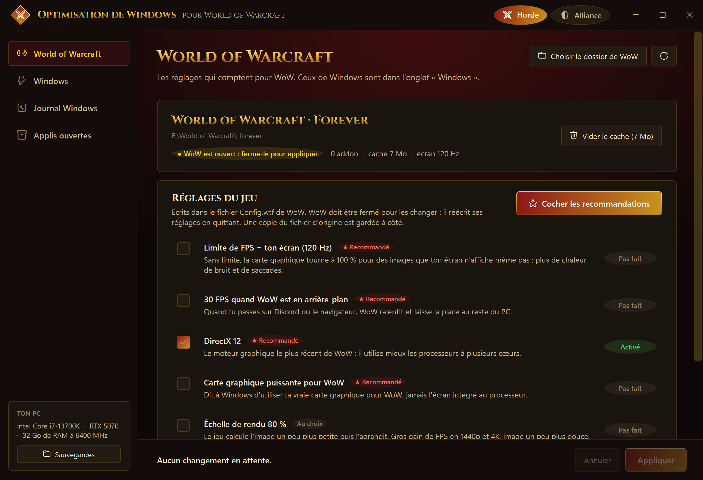
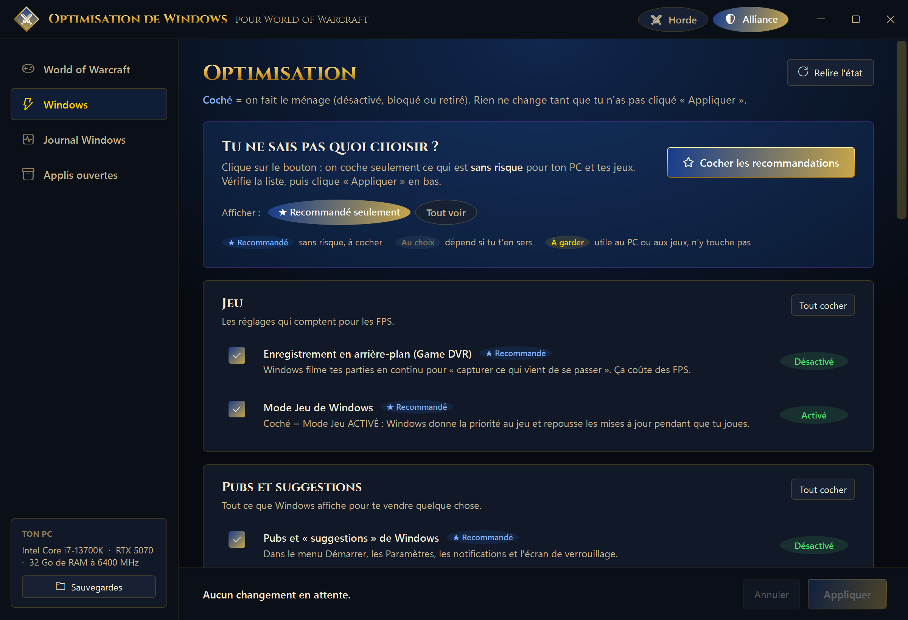
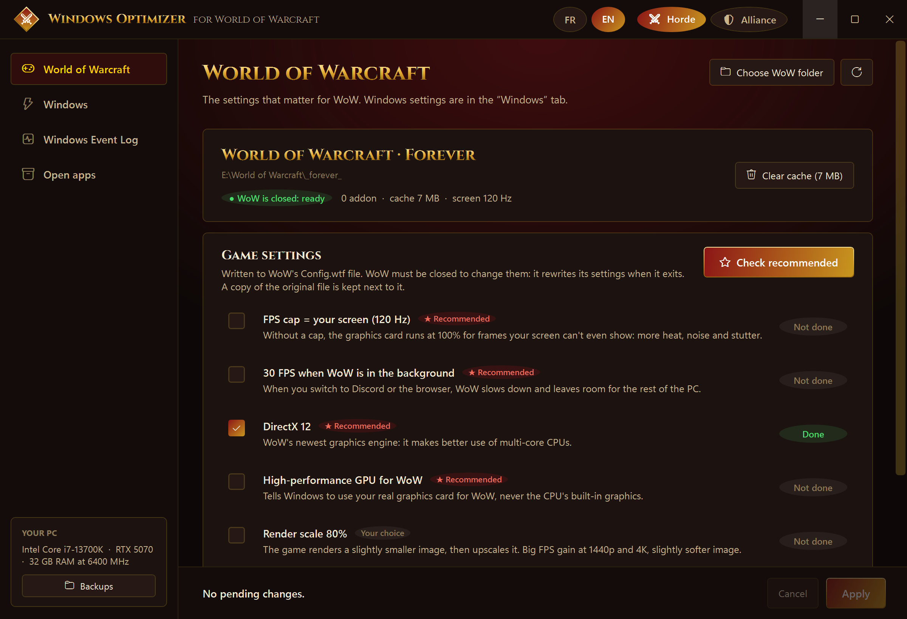

# ⚔ Optimisation de Windows pour World of Warcraft
### Windows Optimizer for World of Warcraft

**[🇫🇷 Français](#-français)** · **[🇬🇧 English](#-english)**

| Horde (FR) | Alliance (FR) | English |
|---|---|---|
|  |  |  |

---

## 🇫🇷 Français

Application **gratuite** pour Windows 10 et 11 qui prépare ton PC pour **World of Warcraft** : moins de saccades, moins de pubs Windows, et un œil sur ce qui mange ta mémoire pendant que tu joues.

Thème **Horde** ou **Alliance** au choix, en un clic. 🛡 L'app est en **français et en anglais** (bouton FR / EN en haut ; au premier lancement, elle suit la langue de Windows).

> Application non officielle, sans lien avec Blizzard Entertainment. *World of Warcraft* est une marque de Blizzard Entertainment, Inc.

---

## Ce que fait l'app

### 🎮 World of Warcraft
Trouve WoW tout seul (Retail, Classic, Classic Era, Forever…) et propose, avec une case à cocher pour chaque :

| Réglage | Pourquoi |
|---|---|
| **Limite de FPS = ton écran** (ex. 120 Hz) | La carte graphique ne tourne plus à 100 % pour rien : moins de chaleur, moins de saccades. |
| **30 FPS en arrière-plan** | WoW laisse la place au reste quand tu vas sur Discord ou le navigateur. |
| **DirectX 12** | Le moteur le plus récent de WoW. |
| **Carte graphique puissante pour WoW** | Windows n'utilise jamais l'écran intégré au processeur pour WoW. |
| **Échelle de rendu 80 %** *(au choix)* | Gros gain de FPS en 1440p et 4K. |
| **VSync désactivée** *(au choix)* | Moins de délai avec la limite de FPS. |
| **Vider le cache de WoW** | Corrige souvent les bugs d'affichage et de chargement. |

Les réglages sont écrits dans `WTF\Config.wtf`. **WoW doit être fermé** (il réécrit ses réglages en quittant). Une copie du fichier d'origine est gardée à côté.

### 🪟 Windows
- Game DVR (enregistrement en arrière-plan), Mode Jeu
- Pubs et « suggestions » de Windows, applis installées en douce, recommandations du menu Démarrer, pub ciblée
- Bing et « faits du jour » dans la recherche, bouton Copilot, widgets
- Programmes lancés au démarrage (bloquer / débloquer)
- Désinstallation des applis Microsoft inutiles (jamais les applis Xbox : des jeux en ont besoin)
- Nettoyage des fichiers temporaires
- **★ Cocher les recommandations** : pour ceux qui ne savent pas quoi choisir, seulement ce qui est sans risque

### 📋 Journal Windows
Les erreurs de Windows regroupées et **expliquées en français** : redémarrages imprévus, écrans bleus, plantages du pilote graphique, erreurs matérielles, disques, applis plantées. Avec un résumé et un verdict.

### 📦 Applis ouvertes
Les programmes **hors Microsoft** qui prennent le plus de mémoire, avec un bouton **Fermer**. Signale en jaune :
- les gros programmes **sans fenêtre**, souvent un jeu ou un launcher mal fermé ;
- un **autre compte Windows resté ouvert** en arrière-plan (« Changer d'utilisateur ») qui garde sa mémoire.

---

## Sécurité
- **Pas besoin des droits administrateur** : l'app ne change que les réglages de ton compte Windows et les fichiers de WoW.
- **Rien ne change sans ton clic** sur « Appliquer ». Chaque case montre l'état réel.
- **Sauvegarde automatique** des réglages avant chaque changement (bouton « Sauvegardes »), et copie de `Config.wtf`.
- Aucune donnée envoyée sur Internet. Aucune pub. Code ouvert.

## Installer
1. Télécharge `Optimisation-WoW.exe` dans les [Releases](../../releases).
2. Lance-le. C'est tout.

## Compiler soi-même
Il faut le [SDK .NET 8](https://dotnet.microsoft.com/download/dotnet/8.0).

```bash
dotnet publish -c Release -r win-x64 --self-contained true -p:PublishSingleFile=true -p:IncludeNativeLibrariesForSelfExtract=true -p:EnableCompressionInSingleFile=true -o publish
```

## Crédits
- Fait par **GhostWalk Studio**.
- Police **Cinzel** et **Cinzel Decorative** © The Cinzel Project Authors, sous [SIL Open Font License 1.1](Fonts/OFL.txt).
- Icônes : Segoe Fluent Icons (incluses dans Windows).

## Licence
[MIT](LICENSE) : libre d'utiliser, modifier et partager.

---

## 🇬🇧 English

A **free** app for Windows 10 and 11 that gets your PC ready for **World of Warcraft**: less stutter, fewer Windows ads, and an eye on what eats your memory while you play.

**Horde** or **Alliance** theme, one click. 🛡 The app is in **English and French** (FR / EN button at the top; on first launch it follows your Windows language).

> Unofficial application, not affiliated with Blizzard Entertainment. *World of Warcraft* is a trademark of Blizzard Entertainment, Inc.

### What it does

#### 🎮 World of Warcraft
Finds WoW by itself (Retail, Classic, Classic Era, Forever…) and offers a checkbox for each:

| Setting | Why |
|---|---|
| **FPS cap = your screen** (e.g. 120 Hz) | The graphics card stops running at 100% for nothing: less heat, less stutter. |
| **30 FPS in the background** | WoW makes room for the rest when you switch to Discord or the browser. |
| **DirectX 12** | WoW's newest graphics engine. |
| **High-performance GPU for WoW** | Windows never uses the CPU's built-in graphics for WoW. |
| **Render scale 80%** *(your choice)* | Big FPS gain at 1440p and 4K. |
| **VSync off** *(your choice)* | Less input lag with the FPS cap. |
| **Clear WoW cache** | Often fixes display and loading glitches. |

Settings are written to `WTF\Config.wtf`. **WoW must be closed** (it rewrites its settings when it exits). A copy of the original file is kept next to it.

#### 🪟 Windows
- Game DVR (background recording), Game Mode
- Windows ads and “suggestions”, silently installed apps, Start menu recommendations, targeted ads
- Bing and search highlights, Copilot button, widgets
- Startup programs (block / unblock)
- Uninstall useless Microsoft apps (never the Xbox apps: some games need them)
- Temporary files cleanup
- **★ Check recommended**: for people who don't know what to pick, only safe changes

#### 📋 Windows Event Log
Windows errors grouped and **explained in plain words**: unexpected restarts, blue screens, graphics driver crashes, hardware errors, disks, crashed apps. With a summary and a verdict.

#### 📦 Open apps
The **non-Microsoft** programs using the most memory, with a **Close** button. Highlights in yellow:
- big programs **without a window**, often a game or launcher that wasn't closed properly;
- **another Windows account still signed in** in the background (“Switch user”) that keeps its memory.

### Safety
- **No admin rights needed**: the app only changes your Windows account settings and WoW's files.
- **Nothing changes until you click** “Apply”. Each line shows the real current state.
- **Automatic backup** of settings before every change (“Backups” button), plus a copy of `Config.wtf`.
- No data sent over the Internet. No ads. Open source.

### Install
1. Download `Optimisation-WoW.exe` from the [Releases](../../releases).
2. Run it. That's it.

### Credits
Made by **GhostWalk Studio**. **Cinzel** and **Cinzel Decorative** fonts © The Cinzel Project Authors, [SIL Open Font License 1.1](Fonts/OFL.txt). [MIT](LICENSE) license.
